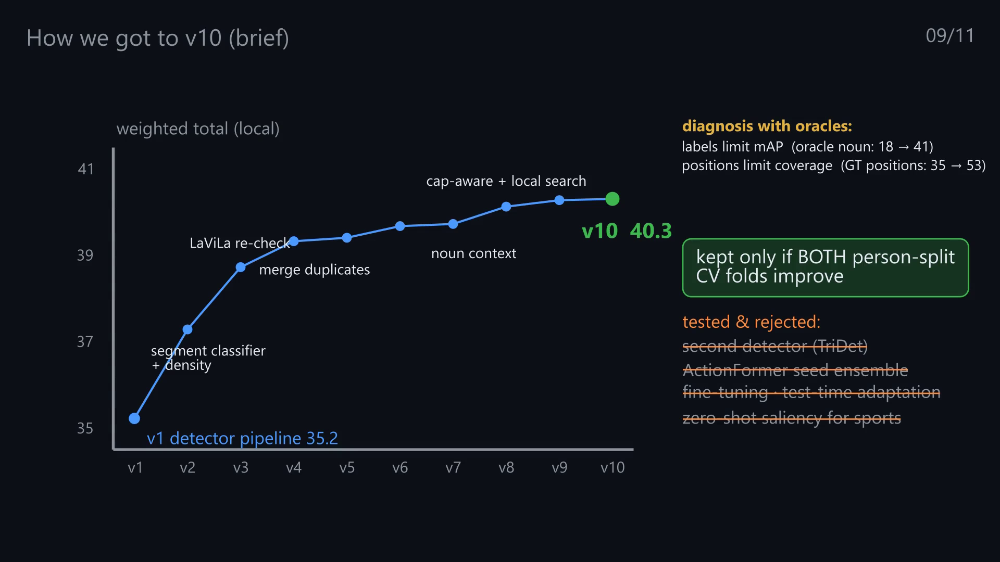

# TIET_Opus5.5high — PRISM XR Hackathon 2026, Track 04: Action-Aware Video Summarization

Team **Opus5.5high** · Thapar Institute of Engineering and Technology (TIET)

**The submission package is [`TIET_Opus5.5high/`](TIET_Opus5.5high/)** (TEAM_ID layout: `run.sh`, `code/`, `weights/`,
`requirements.txt`, `outputs/`, `README.md`, `Dockerfile`). Its [README](TIET_Opus5.5high/README.md) has the architecture,
setup, data used, results and the integrity disclosure.

```bash
git clone https://github.com/vyom-khanna/prismXR.git
cd prismXR/TIET_Opus5.5high
pip install torch torchvision --index-url https://download.pytorch.org/whl/cu128
pip install -r requirements.txt
./run.sh <video.mp4> <out.json>
```

## Video (5 min): architecture, how it works, results

[](demo/TIET_Opus5.5high_video.mp4)

**[▶ Watch the video (demo/TIET_Opus5.5high_video.mp4, 5 min, 1080p)](demo/TIET_Opus5.5high_video.mp4)**:
the final v10 architecture, how each stage works, real outputs, a brief history from v1 to v10, results, and
where the system can be used.

**Demo video (Google Drive):** https://drive.google.com/drive/folders/1gG_aLcU4Mp3Nq-dPiHhkLjqznKbv4hbD?usp=drive_link

Local score on all 187 manifest videos (our re-implementation of the metrics): **weighted total 40.3**
(pair mAP 23.0 · coverage 42.1 · highlight F1 31.6 · label accuracy 98.0).

## Architecture (v10)

One command per video: a CLIP router labels the video, then cooking videos go to the action branch and sports videos
to the highlight branch. Blue = pretrained models (trained by their authors on EPIC-100 train or web data),
orange = models we trained on EPIC-100 train, yellow = routing decision.

```mermaid
flowchart TB
    IN[/"Input video (.mp4)"/]:::io

    subgraph ROUTER["1 · Router: what kind of video is this?"]
        direction TB
        PROBE["ffprobe<br/>duration"]:::step
        FR32["32 evenly spaced frames<br/>(fast seeks)"]:::step
        CLIP["CLIP ViT-L/14 (DataComp-XL)<br/>zero-shot, prompt ensembles<br/>15 classes"]:::model
        LABEL{"label + score<br/>route by content<br/>(never by file name)"}:::decision
        FR32 --> CLIP --> LABEL
    end

    IN --> PROBE
    IN --> FR32

    subgraph EPIC["2a · Action branch: cooking videos (EPIC-KITCHENS)"]
        direction TB

        subgraph PERCEIVE["Find actions"]
            direction TB
            DEC["Decode 30 fps<br/>short side 256"]:::step
            SF["SlowFast-R50<br/>EPIC-100 train<br/>32-frame clips, stride 16<br/>2304-d features + clip verb/noun probs"]:::model
            AFV["ActionFormer: verb detector<br/>97 verbs"]:::model
            AFN["ActionFormer: noun detector<br/>300 nouns"]:::model
            DEC --> SF
            SF --> AFV
            SF --> AFN
        end

        subgraph RECHECK["Re-check every verb segment"]
            direction TB
            SEG["Segment classifier (ours)<br/>mean / max / ±2 s context pooling<br/>verb · noun · 1931-way pair heads"]:::ours
            NMS["Top-300 distinct verb segments<br/>(NMS)"]:::step
            LAV["LaViLa TimeSformer-L<br/>16 frames per segment<br/>verb + noun heads only"]:::model
            NMS --> LAV
        end

        subgraph PAIR["Pair verbs with nouns"]
            direction TB
            EVID["Noun evidence per verb segment<br/>0.3 · overlapping noun detections<br/>+ 0.4 · segment-classifier noun<br/>+ 0.3 · pair head (noun given verb)<br/>LaViLa noun replaces the classifier term where it overlaps"]:::step
            TOP8["Top-8 pairs per segment<br/>score = verb × noun^0.75"]:::step
            ALT["+ LaViLa alternative pairs<br/>top-3 × top-3 verbs × nouns, weight 0.25<br/>(top-5 × top-5 for output actions)"]:::step
            MERGE["Merge duplicates<br/>same pair, tIoU ≥ 0.8, noisy-or<br/>(12 000 candidates before the cap)"]:::step
            EVID --> TOP8 --> MERGE
            ALT --> MERGE
        end

        subgraph OUTACT["Output actions"]
            direction TB
            CTX["Temporal noun-context rescoring<br/>score × (0.1 + ctx)^0.15<br/>co-occurrence matrix from EPIC train, decay exp(−Δt / 10 s)"]:::ours
            CAP["Cap-aware ranking<br/>score / rank^0.35 within each pair<br/>keep top 2000"]:::step
            CTX --> CAP
        end

        subgraph SELECT["Choose highlights (≤ 15 % budget)"]
            direction TB
            SELACT["Selection actions<br/>(built from the top-200 LaViLa segments)"]:::step
            DENS["Action-density model (ours)<br/>expected actions per 0.53 s step"]:::ours
            GREEDY["Greedy budgeted max-coverage<br/>windows of 4–5 s that add the most<br/>new distinct verb–noun pairs + density bonus"]:::step
            LS["Local search<br/>move · resize · swap windows (4–6 s)<br/>while the objective rises"]:::step
            WIDEN["Widen windows with leftover budget<br/>fill to 14.9 %"]:::step
            SELACT --> GREEDY
            DENS --> GREEDY
            GREEDY --> LS --> WIDEN
        end

        AFV --> SEG
        AFV --> NMS
        SF --> SEG
        SF --> DENS
        AFN --> EVID
        SEG --> EVID
        LAV --> EVID
        LAV --> ALT
        MERGE --> CTX
        MERGE --> SELACT
    end

    subgraph SPORT["2b · Highlight branch: sports videos (FPVSum)"]
        direction TB
        F2["Frames at 2 fps"]:::step
        FEAT["Per-frame signals<br/>motion (multi-scale frame difference)<br/>CLIP scene change · CLIP exciting-vs-boring prompt<br/>contrast · brightness · temporal-centre prior · local uniqueness"]:::step
        RIDGE["Importance = ridge mix<br/>(11 weights)"]:::step
        PEAKS["Greedy non-overlapping 4 s peak windows<br/>then widen to 14.9 %"]:::step
        F2 --> FEAT --> RIDGE --> PEAKS
    end

    LABEL -- "cooking" --> DEC
    LABEL -- "sports" --> F2

    subgraph FINAL["3 · Finalize"]
        direction TB
        FIN["Sorted, non-overlapping windows<br/>each ≥ 4.02 s, total ≤ 15 %"]:::step
        VAL["Schema validator"]:::step
        FIN --> VAL
    end

    CAP --> FIN
    WIDEN --> FIN
    PEAKS --> FIN
    PROBE --> FIN
    LABEL --> FIN

    OUT[/"out.json<br/>team_id · video_id · duration_sec<br/>label · actions (verb, noun, segment, score) · highlights"/]:::io
    VAL --> OUT

    classDef io fill:#0b3d2e,stroke:#3fb950,color:#e6edf3,stroke-width:2px
    classDef step fill:#161b22,stroke:#8b949e,color:#e6edf3
    classDef model fill:#1f2a44,stroke:#4c9aff,color:#e6edf3,stroke-width:2px
    classDef ours fill:#3a2410,stroke:#ff8b3d,color:#e6edf3,stroke-width:2px
    classDef decision fill:#3b3110,stroke:#e3b341,color:#e6edf3,stroke-width:2px
```



## How we got to v10



Ten measured versions, from a plain detector pipeline (v1, 35.2) to the final system (v10, 40.3). A change was kept only
if it improved both halves of a cross-validation split by participant; the full log, including rejected ideas, is in
[`PROGRESS.md`](PROGRESS.md).

| Folder | Contents |
|---|---|
| `TIET_Opus5.5high/` | the submission: inference code, all model weights (large ones as <100 MB parts, rejoined by run.sh), 187 output JSONs |
| `tools/` | development only: training scripts for our models, evaluation, tuning and integrity checks (never imported at inference) |
| `research/` | literature review behind the design choices |
| `demo/` | the 5-minute video (architecture, how it works, results) and its thumbnail |
| `AI_DISCLOSURE.md` | how AI assistance (Claude Code) was used, and the AI models inside the system |
| `PROGRESS.md` | experiment log (every change, kept or rejected, with its cross-validation result) |
| `TIET_Opus5.5high_Submission.pptx` | presentation deck |
| `Student package_track04/` | the organiser's student kit (manifest, classes, TEAM_README) |
