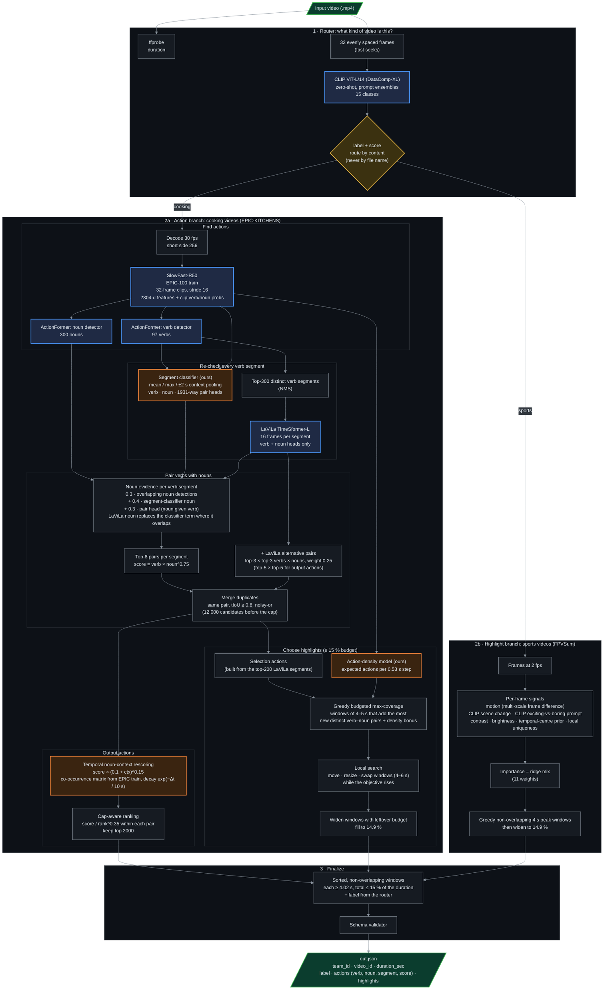

# TIET_Opus5.5high — Action-Aware Video Summarization (PRISM 2026, Track 04)

Team **Opus5.5high**, Thapar Institute of Engineering and Technology (TIET). Team ID: `TIET_Opus5.5high`.

Package layout (TEAM_ID/): `run.sh`, `code/`, `weights/`, `requirements.txt`, `outputs/` (187 JSONs, one per
manifest video), `README.md`, plus `Dockerfile`.

One command per video:

```bash
./run.sh <video.mp4> <out.json>
```

The output is one JSON (`team_id`, `video_id`, `duration_sec`, `label`, `actions`, `highlights`) that
follows the TEAM_README schema. Every output is checked by our own validator before it is written.

**Video (5 min, architecture and results):** [`demo/TIET_Opus5.5high_video.mp4`](../demo/TIET_Opus5.5high_video.mp4) · **Demo video (Google Drive):** https://drive.google.com/drive/folders/1gG_aLcU4Mp3Nq-dPiHhkLjqznKbv4hbD?usp=drive_link

---

## 1. Architecture

Blue = pretrained models, orange = models we trained on EPIC-100 train, yellow = routing decision.



Text version with all settings:

```
video.mp4
  │ ffprobe → duration
  │ 32 evenly spaced frames (fast seeks)
  ▼
CLIP ViT-L/14 (DataComp-XL) zero-shot, prompt ensembles over 15 classes
  → label {name, score}  →  ROUTE by content (never by file name)
  │
  ├─ "cooking" ──► EPIC branch
  │     30 fps stream (short side 256, BGR) → SlowFast-R50 fine-tuned on EPIC-100 train
  │        32-frame clips / stride 16 → 2304-d features + per-clip verb/noun probabilities
  │     ActionFormer (EPIC-100 train) — verb model (97) + noun model (300)
  │     Segment classifier (ours, EPIC-100 train): pools features over each verb segment
  │        (mean / max / ±2 s context) → verb, noun and 1931-way (verb, noun) action heads
  │     LaViLa TimeSformer-L (EPIC-100 train): 16 frames over each of the top-300 distinct verb
  │        segments → verb / noun probabilities (second 30 fps decode pass, only needed frames kept)
  │     Pairing: each verb segment × noun evidence
  │        = 0.3 overlapping noun detections + 0.4 segment-classifier noun + 0.3 action head (noun | verb)
  │        (LaViLa's noun probs replace the segment-classifier noun term where a LaViLa segment overlaps)
  │        → top-8 (verb, noun) actions per segment, score = s_verb · p_noun^0.75
  │        + LaViLa top-3 verbs × top-3 nouns per LaViLa segment at 0.25 weight (top-5 × top-5 for the output actions)
        → same (verb, noun) predictions overlapping at tIoU ≥ 0.8 merged (noisy-or score)  (≤ 2000 actions)
        (pairing keeps up to 12000 candidates before the merge, so the 2000 cap applies after it; highlight
        selection uses actions built from the top-200 LaViLa segments and 2000 candidates)
        → output actions only: temporal noun-context rescoring, score × (0.1 + ctx)^0.15, where ctx = support of
          the action's noun from nouns predicted on other segments nearby (exp(−|Δt|/10 s)), through a noun
          co-occurrence matrix fitted on EPIC-100 train annotations (Kazakos et al. BMVC'21; Pato et al. CVPR'20)
        → which output actions survive the 2000 cap: ranked by score / r^0.35, r = the action's rank (1, 2, ...) among predictions
          of the same (verb, noun) in the video (emitted scores unchanged; cap-aware AP, Dave et al. 2021)
  │     Action-density model (ours, EPIC-100 train): expected action midpoints per 0.53 s step
  │     Coverage-optimal highlights: greedy budgeted max-coverage of DISTINCT (verb, noun) pairs
  │        + 0.2 × expected #actions in the window, 4–5 s windows, fill to 14.9 %,
  │        then a local search moves / resizes / swaps each window (4–6 s) while the same objective rises
        (swap-based refinement of greedy budgeted max-coverage, Khuller–Moss–Naor 1999), leftover budget widens windows
  │
  └─ sports ────► FPVSum branch
        2 fps frames → per-frame importance = ridge combination of motion (multi-scale frame
        difference), CLIP scene change, CLIP "exciting vs boring" prompt score, contrast,
        brightness, temporal-centre prior, local uniqueness
        → greedy non-overlapping 4 s peak windows, then widened to use the leftover budget (14.9 %)
  ▼
finalize (sorted, non-overlapping, every window ≥ 4.02 s so 0.01 s rounding never leaves exactly 4.00 s, ≤ 15 %)
  (videos too short for a 4 s window inside 15 % get one window, still placed by the coverage selection) → validate → out.json
```

Models are loaded one at a time; peak GPU memory ≈ 1.6 GB (fits a 6 GB laptop GPU).

| Component | Source / training data |
|---|---|
| CLIP ViT-L/14, `laion/CLIP-ViT-L-14-DataComp.XL-s13B-b90K` | public pretrained, zero-shot (no fine-tuning) |
| SlowFast-R50 EPIC-100 | `epic-kitchens/epic-kitchens-slowfast` checkpoint (EPIC-100 **train** split) |
| ActionFormer verb / noun | `happyharrycn/actionformer_release` EPIC-100 checkpoints (EPIC-100 **train** split) |
| LaViLa TimeSformer-L EK100-CLS (`lavila/tsf_l_ek100_vn_fp16.pth`, 0.8 GB) | `facebookresearch/LaViLa` checkpoint fine-tuned on EPIC-100 **train**; fp16, **verb and noun heads only**. Its action head is dropped because LaViLa indexes it by a pair list built from train + validation annotations |
| Segment classifier (`epic_segcls.pt`, 43 MB) | trained by us on EPIC-100 **train** annotations + ActionFormer's released train-split SlowFast features (`tools/train_segcls.py`) |
| Noun co-occurrence matrix (`epic_nounctx.npz`, 0.4 MB) | counted by us from EPIC-100 **train** annotations (`tools/build_nounctx.py`) |
| Action-density model (`epic_density.pt`, 7 MB) | trained by us on the same EPIC-100 **train** data (`tools/train_density.py`) |
| Sports importance weights | 11 ridge coefficients **fitted on the FPVSum human importance curves** of the manifest videos (ridge, λ = 100; `tools/fpv_explore.py`). Leave-one-category-out CV (each sport scored with weights fitted without it) gives F1 ≈ 0.30, our honest estimate of generalisation (vs 0.316 in-sample); random 0.12 |
| Pairing / coverage hyper-parameters | a handful of scalar settings (fusion weights, LaViLa top-k/NMS, selection settings, noun-context σ/γ) **chosen on the EPIC-100 validation videos of the manifest** by 2-fold cross-validation split by participant; kept only when both held-out folds improve. No model weights are trained on validation data |

Vendored code (license files kept): SlowFast model definition from epic-kitchens-SlowFast
(`code/prism/slowfast/`, CC BY-NC-SA 4.0), ActionFormer model (`code/prism/actionformer/`, MIT), LaViLa TimeSformer (`code/prism/lavila/`, MIT). ActionFormer's C++ NMS was ported to pure
Python (`actionformer/utils/nms.py`), so nothing needs compiling.

## 2. Setup

```bash
# Python 3.11–3.13, NVIDIA GPU recommended (CPU works, much slower); ffmpeg + ffprobe on PATH
pip install torch==2.11.0 torchvision==0.26.0 --index-url https://download.pytorch.org/whl/cu128
pip install -r requirements.txt
./run.sh sample.mp4 out.json      # or: bash run.sh sample.mp4 out.json
```

Docker: `docker build -t prism . && docker run --gpus all -v /data:/data prism /data/v.mp4 /data/out.json`

### Weights (≈ 2 GB in `weights/`, override with `PRISM_WEIGHTS`)

All weights are included in `weights/`. GitHub limits files to 100 MB, so the five large checkpoints are stored as
`<file>.partNNN` chunks; `run.sh` rejoins them automatically on its first run (`code/prism/join_weights.py`) and checks
each joined file against `weights/MD5SUMS.txt`. Nothing needs to be downloaded or set up.
`weights/MD5SUMS.txt` lists their checksums.

| File | Origin |
|---|---|
| `epic_prior.npz` | P(noun given verb) counted by us from EPIC-100 *train* annotations |
| `epic_segcls.pt` | segment classifier trained by us on EPIC-100 *train* |
| `epic_density.pt` | action-density model trained by us on EPIC-100 *train* |
| `epic_nounctx.npz` | noun co-occurrence counts from EPIC-100 *train* annotations |
| `SlowFast_model.pyth` | epic-kitchens-slowfast EPIC-100 checkpoint (EPIC-100 train), `model_state` only |
| `actionformer/epic_slowfast_{verb,noun}_ema.pth.tar` | ActionFormer EPIC-100 release, EMA weights only |
| `clip/open_clip_fp16.bin` | OpenCLIP ViT-L/14 DataComp.XL (Hugging Face), fp16 |
| `lavila/tsf_l_ek100_vn_fp16.pth` | LaViLa TimeSformer-L EK100-CLS, visual + verb/noun heads, fp16 |

Environment variables: `PRISM_TEAM_ID` (default `TIET_Opus5.5high`), `PRISM_WEIGHTS`, `PRISM_CACHE` (optional
feature cache), `PRISM_FFMPEG` / `PRISM_FFPROBE` (if not on PATH), `PRISM_PYTHON` (interpreter for run.sh).

## 3. Data

- **EPIC-KITCHENS-100**: 138 validation videos from the official downloader. No EPIC validation labels are used
  by the system. The models were trained by their authors on the train split.
- **FPVSum**: 49 videos downloaded with yt-dlp. 48 were obtained. `Scuba_KD74Ywuy9ng` became a **private**
  YouTube video and can't be downloaded. Its output is a clearly marked placeholder (label `other`, score 0,
  evenly spaced highlights) written by `tools/make_placeholders.py`, not by the model.

## 4. Results (our local re-implementation of the four metrics; approximate)

Full end-to-end run of `run.sh`'s pipeline on all 187 manifest videos (our own feature extraction), weighted total **40.3**.

| Metric (weight) | Uniform baseline | **Ours** |
|---|---|---|
| Action mAP, verb–noun pairs, tIoU 0.1–0.5 (25 %) | 0 | **23.0** |
| Action Coverage, distinct GT pairs in highlights (40 %) | 19.2 | **42.1** (upper bound with perfect actions: 61.0) |
| Highlight F1 vs top-15 % human frames (25 %) | 14.1 | **31.6** (human-vs-consensus: 37.6) |
| Label accuracy (10 %) | — | **98.0** (48/49; the one miss is the private-video placeholder) |

The LaViLa settings in `config.py` (number of segments, NMS, match tIoU and fusion weights) were picked on 21 EPIC
validation videos. On the other 117 videos, which were not used for that choice, pair mAP rose from 18.2 to 22.8
and coverage from 38.3 to 40.5 compared with the same pipeline without LaViLa (all later changes were kept only when
both participant-split folds improved).

Latency on an RTX 4050 Laptop (6 GB): sports videos ≈ 0.1× real time, 1080p EPIC videos ≈ 0.7–1.0× real time
(SlowFast decode ≈ 0.25–0.4×; LaViLa ≈ 0.33 s per segment for up to 300 segments plus one decode pass, so short videos
are relatively slower — a 174 s video takes 174 s). Per-stage timings are logged by `run.sh` to stderr.

## 5. Integrity

- The pipeline only reads the video. The file name is used **only** to fill the required `video_id`.
- No ground truth, video-ID lookups or per-video constants appear anywhere in `code/`.
- Deterministic: the same video gives the same JSON.

### Disclosure: use of evaluation annotations during development

All learned models are trained only on EPIC-100 **train** data or are public pretrained checkpoints, and the
inference code never reads any annotation file or video id. During development we did use the annotations of the
manifest videos to choose settings and design choices: the 11 FPVSum ridge weights (fitted on FPVSum importance
curves), and the EPIC hyper-parameters and post-processing steps (noun-context rescoring, cap-aware survivor
ranking, coverage local search and its settings), each kept only if it improved both halves of a participant-split
2-fold CV on EPIC val. Offline error analysis also used the EPIC val annotations. Because many variants were
compared on these videos, the local numbers in section 4 are somewhat optimistic: FPVSum leave-one-category-out
F1 is ≈ 0.30 (vs 0.316 in-sample), and we estimate the weighted total on unseen videos at roughly 39.5–40
(local: 40.3).
